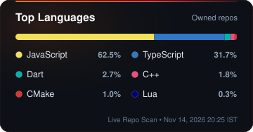

  

    

  <h1 align="center">Hi, I'm Anivesh Sikarwar 👋</h1>

  

    <b>Full-Stack Developer</b> interested in <b>Backend Engineering &amp; System Design</b>. 
    Building scalable, production-oriented software systems &amp; strengthening DSA fundamentals.
  

  

    <a href="https://github.com/Anivesh91">GitHub</a> ·
    <a href="https://www.linkedin.com/in/anivesh-sikarwar-6a9a12314">LinkedIn</a> ·
    <a href="mailto:aniveshsikarwar@gmail.com">Email</a> ·
    <a href="https://instagram.com/_a_n_i_v_e_s_h_">Instagram</a>
  

  

    
    
    
  

---

### 🔭 What I'm Up To
- 🎓 **Education:** B.Tech in Computer Science & Engineering at **SGSITS, Indore**
- 💻 **Building:** Production-grade Full-Stack & Backend projects
- 🌱 **Learning:** System Design, Cloud Infrastructure, DevOps & Production Deployment
- ⚙️ **Core Stack:** React, Next.js, Node.js, Express, PostgreSQL, MongoDB, Redis & Docker

---

### 💻 Tech Stack

  
  
  
  
  
  
  
   
  
  
  
  
  

---

### 📊 GitHub Analytics

  
  
    
  

---

### 🐍 Contribution Snake

  <picture>
    <source media="(prefers-color-scheme: dark)" srcset="https://raw.githubusercontent.com/Anivesh91/Anivesh91/output/github-snake-dark.svg" />
    <source media="(prefers-color-scheme: light)" srcset="https://raw.githubusercontent.com/Anivesh91/Anivesh91/output/github-snake.svg" />
    
  </picture>

---

  

